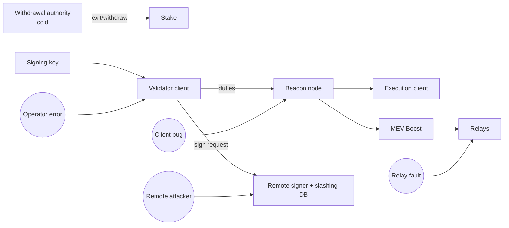

# Why Validators Get Hurt: A Threat Model

Running a proof-of-stake validator looks simple on paper: keep a machine online, let it sign duties when asked, collect rewards. In practice most losses suffered by professional operators do not come from clever cryptographic attacks. They come from operational mistakes — a key copied to a second machine during a migration, a slashing-protection database left behind, a monitoring gap that hides a week of missed attestations, or a relay that misbehaves at the wrong moment. This book treats validator operations as a security discipline in its own right. Examples use Ethereum, but the reasoning carries over to most proof-of-stake chains.

## What is at stake

A validator holds two kinds of value. The first is the stake itself, which can be lost through slashing or stolen if withdrawal authority is compromised. The second is the stream of rewards and the operator's reputation, which can be lost through downtime, missed proposals, or a public slashing event that clients notice. Different failures hit different assets, so the threat model must keep them apart.

| Asset | Main threat | Typical cause |
|---|---|---|
| Staked principal | Theft | Compromised withdrawal credentials or seed phrase |
| Staked principal | Slashing | Same signing key active in two places, lost protection DB |
| Rewards | Inactivity penalties | Outages, sync problems, client bugs |
| Rewards / MEV | Lost or stolen block value | Relay faults, misconfigured fee recipient |
| Reputation | Public slashing, long outages | Any of the above |

## The two keys

On Ethereum, each validator has a BLS **signing key** that is used constantly, for every attestation and proposal, and **withdrawal credentials** that decide where the stake goes when the validator exits. The signing key must live on, or be reachable from, an online machine. The withdrawal authority — either a BLS withdrawal key (`0x00` credentials) or an execution-layer address (`0x01` and, since the Pectra upgrade, `0x02` compounding credentials) — should never be online in the same place. Chapter 2 covers this split in detail. The key point for the threat model is that an attacker who steals only the signing key can cause slashing but cannot redirect withdrawals, while an attacker with the withdrawal authority can eventually take the money.

## Slashing in one paragraph

A validator is slashed for provably contradictory messages: proposing two different blocks for the same slot, casting two different attestations for the same target epoch, or casting an attestation that "surrounds" or is surrounded by one of its own earlier attestations. Slashing removes part of the stake immediately, applies a further correlation penalty that grows when many validators are slashed in the same window, and forcibly exits the validator. An isolated mistake is relatively cheap; a correlated failure across a large operator is expensive. That makes shared infrastructure — one remote signer, one migration script, one cloud account — the most important thing to protect.

## Adversaries and failure sources

Who or what can hurt a validator:

- **The operator.** Most public slashings have been traced to operator error, often during migrations or failover. Staked reported a slashing of dozens of validators in early 2021 after an infrastructure issue, and in 2023 a Lido node operator reported a slashing of around twenty validators linked to a migration. These reports are the best evidence that the biggest threat is your own runbook.
- **Remote attackers.** They target exposed APIs (beacon node, validator client keymanager API, signer HTTP endpoints), cloud credentials and CI pipelines that hold keystores.
- **Insiders and vendors.** Hosting providers, staking-as-a-service partners and DVT co-operators all have some reach into your setup.
- **Software.** Consensus and execution client bugs, especially in a client used by a supermajority, can cause mass penalties.
- **Counterparties.** MEV-Boost relays and builders are trusted to deliver valid payloads and to pay what they promised.

## Design principles used in this book

1. **One signing key, one active signer, always.** Every control around keys exists to enforce this.
2. **Slashing protection travels with the key.** Moving a key without its history is the classic route to a double vote.
3. **Prefer being offline to being slashed.** Missing a few hours of attestations costs a little; a double sign costs a lot more. Failover must be deliberately slow.
4. **Separate hot and cold.** Withdrawal authority never shares a machine, account or person with daily operations.
5. **Diversify what you cannot verify.** Use minority clients and multiple relays, and consider distributed validator technology (DVT) to remove single points of failure.

## Worked example

*Execution status: the commands, code and numbers in this example were not executed in this book's CI; they are illustrative. Verify locally on a devnet, testnet or fork before relying on them.*

A small operator runs 40 validators on one host and is planning a move to a new data centre. Walk through the threat model as a table-top exercise:

1. List assets: 40 signing keys in EIP-2335 keystores, one mnemonic in a safe, `0x01` withdrawal credentials pointing at a Safe multisig.
2. List components: one execution client, one beacon node, a validator client with a local slashing-protection database, MEV-Boost with three relays.
3. For each component, ask "what if it fails" and "what if it is compromised". Example: the validator client host is compromised, so the attacker gets 40 signing keys. Impact: possible slashing of all 40, but the stake still withdraws to the multisig.
4. Ask "what if we run it twice". The migration plan copies keystores to the new host before shutting down the old one. This is the single highest-risk step in the whole plan.
5. Decide controls: stop the old client, export the EIP-3076 interchange file, wait at least two epochs, import it on the new host, enable doppelganger protection, start. Chapter 4 runs this on a devnet.

The output is a ranked list in which "duplicate signer during migration" sits above every remote-attacker scenario.

## Common pitfalls

- Treating slashing as an exotic attack rather than the predictable result of running one key twice.
- Storing the mnemonic or withdrawal key on the same cloud account as the validator hosts.
- Building automatic failover that starts a backup signer whenever the primary looks unhealthy.
- Concentrating every validator behind one signer or one client, so a single fault becomes a correlated one.
- Ignoring relay and builder trust because MEV-Boost "just works".

## Exercises

1. Draw the component diagram for your own (or a hypothetical) setup and mark every place a signing key exists, including backups and CI secrets.
2. Read two public validator slashing post-mortems and classify the root cause as operator, software or attacker.
3. Using a local Kurtosis `ethereum-package` devnet, find where each client stores its slashing-protection data on disk.

## Further reading

- Ethereum consensus specs, phase0 and Electra validator guides: <https://github.com/ethereum/consensus-specs>
- EIP-3076: Slashing Protection Interchange Format
- ethereum.org staking documentation: <https://ethereum.org/en/staking/>
- Related books: **restaking-shared-security-risk**, **p2p-network-attacks**, **mev-security-engineering**
