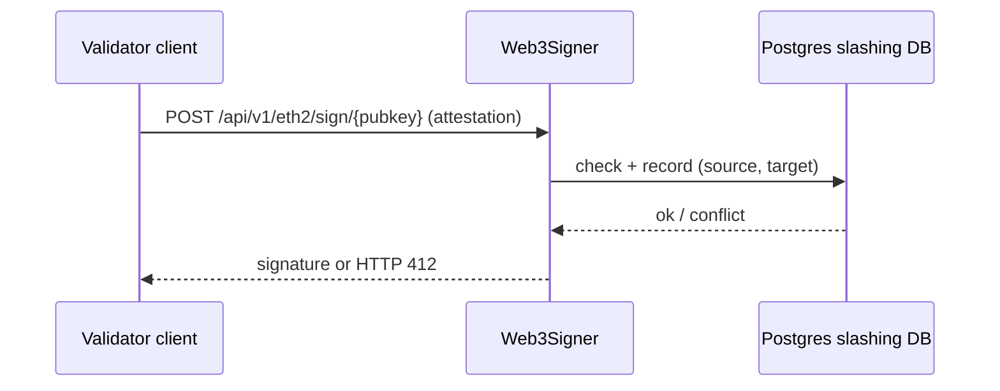

# Slashing Protection and Remote Signers

Slashing protection is a local database of everything a key has signed, consulted before every new signature. It is the last line of defence against double votes and surround votes, and unlike consensus-layer rules it is entirely the operator's responsibility. This chapter explains how it works, how the EIP-3076 interchange format moves it between tools, and how remote signers such as Web3Signer centralise it.

## How the check works

Before signing a block, the signer checks it has not already signed a different block for the same slot. Before signing an attestation, it checks the new `(source_epoch, target_epoch)` pair against history:

- **Double vote:** same target epoch, different signing root.
- **Surround vote:** the new attestation has a lower source and higher target than an existing one, or is surrounded by one.

Most clients implement a conservative "minimal" rule as well: refuse anything at or below the highest slot or epoch already signed. This makes the database smaller and the check simpler, at the cost of refusing some messages that would technically be safe.

If the database is empty, the signer has no history and will sign anything. That is why losing or skipping the database during a migration is dangerous: a fresh signer and an old one can both be "safe" from their own point of view while together producing a slashable pair.

## EIP-3076 interchange format

EIP-3076 defines a JSON format so slashing history can be moved between clients. The current format version is `5`.

```json
{
  "metadata": {
    "interchange_format_version": "5",
    "genesis_validators_root": "0x4b36...(32-byte root of the target network)"
  },
  "data": [
    {
      "pubkey": "0xb845...",
      "signed_blocks": [
        { "slot": "81952", "signing_root": "0x4ff6..." }
      ],
      "signed_attestations": [
        { "source_epoch": "2290", "target_epoch": "3007", "signing_root": "0x5873..." }
      ]
    }
  ]
}
```

Two fields deserve attention. `genesis_validators_root` binds the file to one network; importing a mainnet file into a testnet client should fail, and so should the reverse. `signing_root` is optional, and many exports use the minimal form that only records the highest slot and epochs. That is sufficient for protection but loses detail useful for forensics.

Each client exposes import and export:

| Client / signer | Export | Import |
|---|---|---|
| Lighthouse | `lighthouse account validator slashing-protection export <file>` | `... slashing-protection import <file>` |
| Teku | `teku slashing-protection export --to=<file>` | `teku slashing-protection import --from=<file>` |
| Prysm | `prysm.sh validator slashing-protection-history export` | `... import` |
| Web3Signer | `web3signer eth2 export --to=<file>` | `web3signer eth2 import --from=<file>` |

Flags vary between releases, so check each tool's `--help`. The point is that every major client supports the same file, which makes migrations between clients possible without losing history.

## Remote signers

A remote signer separates keys and slashing protection from the validator client. The validator client sends a signing request over HTTP; the signer checks its database and returns a signature or a refusal. Web3Signer (from Consensys) is the most widely used, with a PostgreSQL slashing-protection database. Dirk (from Attestant) is a distributed signer that can also split keys with threshold signing and is typically paired with the Vouch validator client.



Benefits are real: keys never touch the validator client host, a single protection database covers all clients, and you can swap or restart validator clients without moving keys. The risks move too:

- **The signer becomes a high-value target.** Its HTTP API signs anything it is allowed to sign. Bind it to a private network, require TLS with client certificates, and never expose it publicly.
- **The database is now critical.** If Postgres is lost and restored from an old backup, the signer has stale history. Use replication and treat restores as a slashing-risk event that requires waiting out recent epochs.
- **Two signers, one key.** Running two Web3Signer instances against two different databases with the same keys defeats protection. Multiple instances must share one database.

## Worked example

*Execution status: the commands, code and numbers in this example were not executed in this book's CI; they are illustrative. Verify locally on a devnet, testnet or fork before relying on them.*

Run Web3Signer with Postgres against a local devnet, then prove that it refuses a double vote.

1. Start Postgres in Docker and apply Web3Signer's migration scripts (shipped in the release under `migrations/postgresql`) using Flyway or `psql`.
2. Put one devnet keystore and a matching key config YAML in `./keys`.
3. Start the signer:

```bash
web3signer --key-store-path=./keys --http-listen-host=127.0.0.1 --http-listen-port=9000 \
  eth2 --network=<devnet-config-or-name> \
  --slashing-protection-db-url=jdbc:postgresql://localhost/web3signer \
  --slashing-protection-db-username=postgres --slashing-protection-db-password=pass
```

4. Point a Lighthouse validator client at it by adding an entry with `type: web3signer` and `url: http://127.0.0.1:9000` to `validator_definitions.yml`. Start it and confirm attestations appear in the beacon API.
5. Query the database: `SELECT * FROM signed_attestations ORDER BY target_epoch DESC LIMIT 5;` and match rows to the validator's duties.
6. Stop the validator client. Using the signer's HTTP API directly, submit an attestation signing request for an already-signed target epoch with a different block root. The signer should refuse; record the response code.
7. Export with `web3signer eth2 export --to=history.json` and inspect the JSON against the format above.

## Common pitfalls

- Disabling slashing protection to "fix" a client that refuses to sign after a restore.
- Importing interchange files without checking `genesis_validators_root` or which keys they cover.
- Restoring the signer database from a snapshot taken hours earlier and restarting immediately.
- Exposing the signer API on `0.0.0.0` without TLS or client authentication.
- Running a second signer "for redundancy" with its own database.

## Exercises

1. Export slashing history from Lighthouse on a devnet, import it into Teku, and confirm Teku refuses a message Lighthouse already signed.
2. Write a validator for EIP-3076 files that checks format version, genesis root and that no pubkey appears twice.
3. Simulate a database restore from an old snapshot in your devnet and measure how many epochs you must wait before restarting is safe.

## Further reading

- EIP-3076: Slashing Protection Interchange Format
- Web3Signer documentation: <https://docs.web3signer.consensys.io>
- Dirk: <https://github.com/attestantio/dirk>
- Lighthouse book, slashing protection chapter: <https://lighthouse-book.sigmaprime.io>
- Related book: **mpc-wallet-security**
