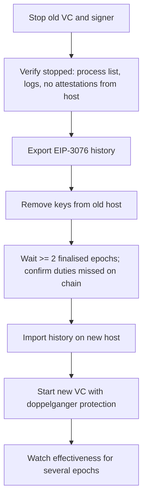

# Migrations, Failover and Double-Sign Risk

Most validator slashings happen when operators are trying to improve reliability. A host fails, a backup comes up, the primary recovers, and two signers now hold the same key. Or a team moves keys to new infrastructure and forgets to bring the slashing history. This chapter treats migration and failover as the most dangerous routine operations and gives a procedure that trades a little downtime for safety.

## Why failover is different for validators

In ordinary web services, active-active redundancy is good practice. For validators it is the definition of a slashable configuration. Two validator clients with the same key will each see the same duties and each produce an attestation. If their beacon nodes have slightly different views of the chain — which happens routinely — the attestations differ, and that is a double vote.

The asymmetry between costs drives the design. Missing attestations for an hour costs roughly what the validator would have earned in that hour, plus a similar amount in penalties. A slashing costs a meaningful fraction of the stake plus forced exit, and correlated slashing across many keys costs much more. A sensible policy is therefore: **failover is manual, deliberate and slow**.

## Sources of duplicate signers

| Scenario | How it happens |
|---|---|
| Hot spare | Backup host started "temporarily" while the primary is only partly down |
| Network partition | Primary appears dead to the orchestrator but still reaches peers |
| Orchestrator restart | Kubernetes or systemd starts a second replica during rolling updates |
| Migration overlap | New host started before the old one is confirmed stopped |
| Restored snapshot | VM snapshot of an old validator host booted for debugging |
| Stale database | Signer restarted with history from before recent signatures |

The partition case is the subtle one. Health checks that rely on the orchestrator's view cannot tell "dead" from "unreachable from here". Several public slashings have been attributed to exactly this pattern of automated redundancy.

## Controls

**Make duplicate signing structurally hard.** Use a single remote signer with one shared database for all validator clients, so even if two clients run, only one signature per duty gets out. With DVT (Chapter 5), require a threshold of independent nodes.

**Enable doppelganger protection.** Lighthouse (`--enable-doppelganger-protection`), Teku (`--doppelganger-detection-enabled`), Nimbus and Prysm offer a mode where the client watches the network for a few epochs on start-up and refuses to sign if it sees its own keys attesting. It costs two or three epochs of missed duties on each restart. It is a useful backstop, but it only detects a duplicate that is already live; it does not detect one started afterwards.

**Never run replicas.** In Kubernetes, use a `StatefulSet` with `replicas: 1` and avoid strategies that start the new pod before the old one terminates. In systemd, disable automatic start on backup hosts.

**Fence the old host.** Before starting anything new, make the old signer unable to sign: stop the service, remove or rename keystores, revoke its network access to the beacon node or signer, or power the machine off. Verify, do not assume.

## Migration procedure

The waiting step matters. Confirming on a block explorer or via the beacon API that your validators are missing attestations proves that nothing else is signing for them. Only then is it safe to start the new host.

## Worked example

*Execution status: the commands, code and numbers in this example were not executed in this book's CI; they are illustrative. Verify locally on a devnet, testnet or fork before relying on them.*

Rehearse a migration and a deliberate failure on a local devnet created with Kurtosis `ethereum-package`.

1. Launch a devnet with two consensus/execution pairs. Note the validator index ranges assigned to node A.
2. Use the beacon API to fetch attestation performance for one validator: `curl localhost:<port>/eth/v1/validator/liveness/<epoch>` with the validator index in the body (or use the client's validator monitor metrics).
3. Stop node A's validator client. Export its slashing protection with its client's export command.
4. Wait two epochs. Confirm liveness shows `is_live: false` for the affected indices.
5. Copy the keystores and the interchange file to node B's environment, import the history, and start a second validator client with doppelganger protection on. Watch it wait before signing.
6. Now break the rules on purpose, on the devnet only: start the original validator client on node A again without stopping B. Watch the logs. If both clients sign conflicting messages, the devnet's slasher (Lighthouse has a `--slasher` option) should detect it and include a slashing in a block. Record how quickly the validator is marked `slashed: true`.
7. Write up the timings and use them to set your production waiting rule.

## Common pitfalls

- Treating doppelganger protection as a guarantee rather than a start-up check.
- Health checks that trigger automatic signer failover.
- Forgetting VM snapshots, golden images and backups that contain keystores.
- Copying keystores without slashing history because "the new client will sync it".
- Runbooks that say "stop old host" without a verification step anyone signs off.

## Exercises

1. Write a migration runbook for your setup with an explicit verification and sign-off at each step.
2. On a devnet, measure how many epochs doppelganger protection delays signing in two different clients.
3. Write a Kubernetes manifest for a validator client that cannot run two pods at once, and test a rolling update to confirm.

## Further reading

- Lighthouse book: doppelganger protection and slasher chapters
- Teku documentation: doppelganger detection
- Kurtosis ethereum-package: <https://github.com/ethpandaops/ethereum-package>
- Public slashing post-mortems from staking operators (search operator blogs and the Lido research forum)
