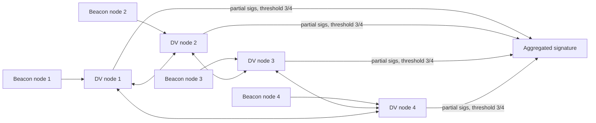

# DVT, Client Diversity and MEV-Boost Relay Trust

A validator depends on more than its own keys. It depends on the client software that tells it what to sign, on the other operators it might share a key with, and on the relays that hand it block payloads. This chapter covers three ways of managing those dependencies: distributed validator technology (DVT), client diversity, and careful MEV-Boost configuration.

## Distributed validator technology

DVT splits one validator's signing key into shares held by several nodes, often run by different operators. Each node runs its own consensus and validator logic, the nodes agree on what to sign through a consensus protocol, and a threshold of them (for example 3 of 4) produce partial BLS signatures that combine into one valid signature. No single node holds the full key, and no single node can make the validator sign.



Two widely used implementations are **Obol** (the Charon middleware, sitting between a normal validator client and beacon node) and **SSV Network** (operators run SSV nodes and are selected and paid through on-chain contracts). Both rely on threshold BLS.

What DVT improves:

- **Fault tolerance.** With 4 nodes and threshold 3, one node can be offline without missed duties.
- **Slashing resistance.** A single misconfigured or compromised node cannot sign alone. A double vote needs a threshold of nodes to misbehave.
- **Key exposure.** With a distributed key generation (DKG) ceremony, the full key never exists on one machine.

What DVT adds:

- **New consensus and networking code** between nodes, with its own bugs.
- **Operator trust.** A threshold of colluding operators can still slash the validator. In SSV, choosing operators is a trust decision.
- **Key generation choices.** If shares are created by splitting an existing key rather than by DKG, the full key existed somewhere and may still.
- **Coordination costs** for upgrades, incidents and migrations across organisations.

## Client diversity

Ethereum has several consensus clients (Lighthouse, Prysm, Teku, Nimbus, Lodestar, Grandine) and execution clients (Geth, Nethermind, Besu, Erigon, Reth). Diversity matters because of how finality works. If a client with more than two-thirds of stake has a bug that makes it finalise an invalid chain, its validators are stuck on that chain and cannot easily return without slashable votes. If a buggy client has more than one-third, it can stop finality for everyone, causing inactivity penalties to accumulate.

Public incidents illustrate the risk. In May 2023 Ethereum mainnet lost finality twice in two days; post-incident analysis attributed it to how some consensus clients handled a burst of old attestations, and finality recovered once clients caught up and patches shipped. In February 2025 the Holesky testnet lost finality for an extended period after several execution clients were misconfigured with the wrong deposit contract address during the Pectra fork; the episode led to the creation of the Hoodi testnet. Both events were survivable partly because no single client dominated.

For an operator, practical diversity means:

- Prefer minority clients where you can operate them competently.
- Large operators should split validators across at least two consensus and two execution clients.
- DVT clusters should mix clients across nodes, which most DVT setups support.

## MEV-Boost and relay trust

MEV-Boost lets a proposer outsource block building. Builders send blocks to relays; the relay shows the proposer a header and bid; the proposer signs the blinded header; the relay then publishes the full payload. The proposer cannot see the payload before signing, so it trusts the relay to:

1. Deliver a valid payload after receiving the signature.
2. Report bids honestly and ensure the builder actually pays the fee recipient.
3. Not leak or misuse private order flow.

If a relay withholds the payload after the proposer signs, the slot is missed. In April 2023 a malicious validator exploited a flaw in the relay's unblinding flow to see and rearrange block contents, taking an amount widely reported at around 20–25 million US dollars from MEV searcher bots; relays added checks afterwards. The lesson for operators is that relays are trusted parties whose behaviour changes with releases.

Configure MEV-Boost defensively:

```bash
mev-boost -hoodi \
  -relay-check \
  -min-bid 0.02 \
  -relays https://0xpubkeyA@relay-a.example,https://0xpubkeyB@relay-b.example
```

`-relay-check` makes the proposer stack check relay health at start-up, and `-min-bid` falls back to locally built blocks when bids are low, limiting the value of a failed relay interaction. Most consensus clients also have a circuit breaker that stops using builders after recent missed slots on the chain. Choose several relays with different operators, pin their public keys, and record which relay delivered each block so you can audit payments.

## Worked example

*Execution status: the commands, code and numbers in this example were not executed in this book's CI; they are illustrative. Verify locally on a devnet, testnet or fork before relying on them.*

Estimate the trade-off between a solo validator setup and a 3-of-4 DVT cluster using illustrative numbers.

1. Assume each node has independent 99.0% uptime. A solo validator then attests about 99.0% of the time.
2. For a 3-of-4 cluster, the validator works if at least 3 of 4 nodes are up: P = p⁴ + 4p³(1−p) with p = 0.99, giving ≈ 0.9606 + 0.0388 = 0.9994, or 99.94%.
3. For slashing via a compromised node: solo needs one compromise; the cluster needs three of four. If each compromise is independent with yearly probability 1%, the cluster figure is roughly 4 × 0.01³, about 4 in a million.
4. Now add correlation: if all four nodes run the same client and that client has a bug, the uptime gain vanishes for that bug. Repeat with a 1% chance of a shared-client fault and see how much of the benefit remains.

## Common pitfalls

- Splitting an existing key into DVT shares and then forgetting the original keystore exists.
- Picking DVT operators who all use the same cloud provider and client.
- Running every validator on the majority client because it is easiest.
- Configuring a single relay, or unpinned relay URLs.
- Never checking that relay-promised payments arrived at the fee recipient.

## Exercises

1. Run an Obol Charon cluster locally using its documentation's quickstart and stop one node to observe continued attestations.
2. Write a script that compares MEV-Boost bid values logged by your client with fee recipient balance changes for the same blocks on a testnet.
3. Compute cluster availability for 4-of-7 and 5-of-7 thresholds and decide which you would use.

## Further reading

- Obol documentation: <https://docs.obol.org>
- SSV Network documentation: <https://docs.ssv.network>
- MEV-Boost: <https://github.com/flashbots/mev-boost>
- Client diversity data: <https://clientdiversity.org>
- Related books: **mev-security-engineering**, **restaking-shared-security-risk**, **consensus-protocol-fuzzing**
